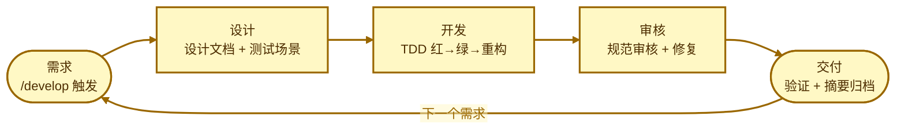
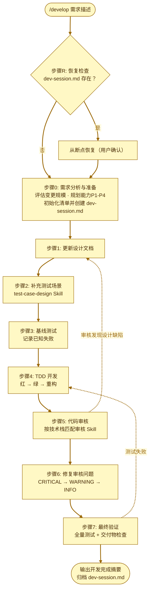

# Workflow - 开发工作流 Skill

Claude Code 自定义 Skill 资源包，提供可重复执行的开发工作流，适用于已有项目的需求变更、缺陷修复等开发工作。

## 安装

将 `.claude` 目录复制到用户主目录下即可全局生效（所有项目均可使用）：

```bash
# Windows
xcopy /E /I .claude %USERPROFILE%\.claude\

# macOS / Linux
cp -r .claude ~/.
```

也可安装到单个项目根目录下，仅对该项目生效：

```bash
cp -r .claude /path/to/your-project/
```

安装后，通过 `/develop {需求描述}` 调用工作流。

## 目录结构

```
00-workflow/
├── .claude/
│   └── skills/
│       └── develop/
│           └── SKILL.md              # 开发工作流 Skill
├── develop.md                         # 源文档
└── README.md                          # 本文件
```

## 迭代循环（理念视图）



> 每转一圈 = 交付一个需求。`dev-session.md` 记录进度，任意一步中断后由步骤R 从断点续跑。

## 工作流图（执行视图）



> 每个步骤完成时更新 `dev-session.md`，支持任意阶段中断后恢复（步骤R）。

## Skill 说明

### develop

开发工作流，8步串行执行：

| 步骤 | 内容 |
|------|------|
| 步骤0 | 需求分析与准备 — 解析需求、评估规模、初始化变更清单 |
| 步骤1 | 更新设计文档 — 将需求变更反映到设计文档 |
| 步骤2 | 补充测试场景 — 使用 test-case-design Skill 设计用例 |
| 步骤3 | 基线测试 — 确认现有测试状态 |
| 步骤4 | TDD开发 — 红→绿→重构 |
| 步骤5 | 代码审核 — 按项目技术栈匹配 Skill 审核 |
| 步骤6 | 修复审核问题 — CRITICAL/WARNING 逐条修复 |
| 步骤7 | 最终验证 — 测试通过 + 交付物检查 |

**依赖的其他 Skill：**
- `test-case-design` — 步骤2 测试用例设计
- `java-coding-review` / `mysql-coding-review` 等 — 步骤5 代码审核

**变更规模适配：**
- 大改（核心逻辑/新功能）：全步骤执行，覆盖率 >= 80%
- 中改（单模块功能）：全步骤执行，覆盖率 >= 70%
- 小改（bugfix/配置）：可跳过步骤2，覆盖变更部分即可
