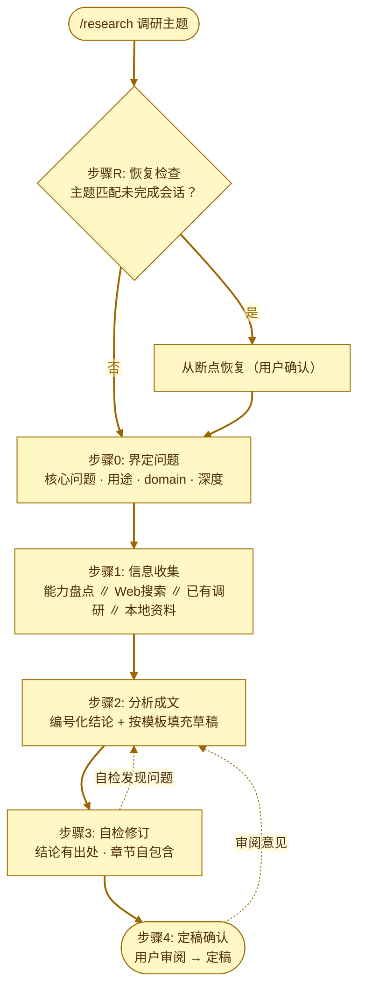

# Research - 调研工作流 Skill

Agent Skill 资源包（遵循 [Agent Skills](https://agentskills.io/specification) 开放标准格式），将日常咨询（工作、技术、生活）沉淀为标准格式的调研文档：断点续跑的工作流 + 标准化文档模板，产出的调研文档沉淀为个人知识库。

## 安装

`.agents/skills/` 是跨工具的 Agent Skills 约定目录，Codex 与 OpenCode 原生识别。将其复制到用户主目录下即可全局生效（所有项目均可使用）：

```bash
# Windows
xcopy /E /I .agents %USERPROFILE%\.agents\

# macOS / Linux
cp -r .agents ~/.
```

也可安装到单个项目根目录下，仅对该项目生效：

```bash
cp -r .agents /path/to/your-project/
```

安装后，通过 `/research {调研主题}` 调用（Codex 也可自然语言触发）。

### Claude Code

Claude Code 读取 `.claude/skills/`、不识别 `.agents/`，需将 skill 复制一份（内容无需改动）：

```bash
# 全局安装（所有项目可用）
mkdir -p ~/.claude/skills && cp -r .agents/skills/research ~/.claude/skills/

# 或安装到单个项目根目录（仅该项目生效）
mkdir -p /path/to/your-project/.claude/skills && cp -r .agents/skills/research /path/to/your-project/.claude/skills/
```

安装后，通过 `/research {调研主题}` 调用；重启会话后生效。

## 目录结构

```
05-research/
├── .agents/
│   └── skills/
│       └── research/
│           ├── SKILL.md              # 调研工作流 Skill（单一事实来源）
│           └── assets/
│               └── template.md       # 调研文档模板
├── docs/                             # 相关调研沉淀
└── README.md                         # 本文件
```

## 输出约定

- **默认输出目录**：`~/workspace/research/`（不存在时由工作流自动创建；步骤0可覆盖）
- **目录组织**：`{domain}/{主题}-YYYYMMDD.md`，domain 为主题自然大类（优先复用已有目录，拿不准时询问用户确认）；细分主题放 tags 标签，作为跨目录检索主通道
- **会话文件**：`research-session-{主题}.md`（输出目录根下，每个调研一个，支持多调研并行）

## 工作流图（执行视图）



> 每个步骤完成时更新会话文件（`research-session-{主题}.md`），支持任意阶段中断后恢复（步骤R）。

## Skill 说明

### research

调研工作流，步骤R/0→4 串行执行：

| 步骤 | 内容 |
|------|------|
| 步骤0 | 界定问题 — 核心问题、用途、时效、domain、调研深度，用户确认 |
| 步骤1 | 信息收集 — 盘点本地 Skill/MCP 能力，Web 搜索 / 已有调研 / 本地资料，多来源并行 |
| 步骤2 | 分析成文 — 编号化结论（每条带出处），按模板填充草稿 |
| 步骤3 | 自检修订 — 结论可追溯、章节自包含、frontmatter 完整 |
| 步骤4 | 定稿确认 — 用户审阅、修正、定稿，写入完成摘要 |

**调研深度分级**：快查（单点问题，摘要+结论即可）/ 标准（选型对比、操作流程）/ 深度（领域级、多来源交叉验证）。

**依赖的其他 Skill**：无。
